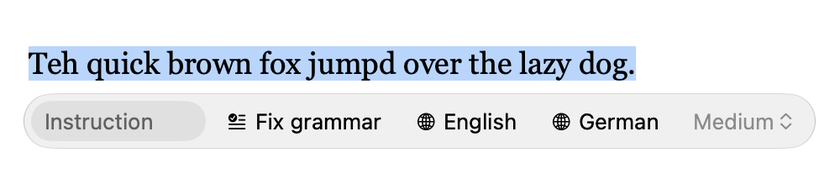
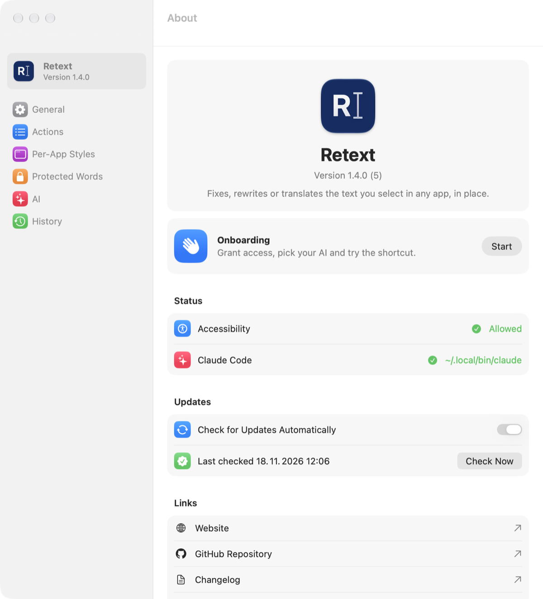

# Retext

**Fix grammar, translate and rewrite selected text in any macOS app, in place, with one shortcut.** A native SwiftUI menu-bar app with a Liquid Glass bar, powered by your own [Claude Code](https://code.claude.com/docs/en/overview) or ChatGPT ([Codex CLI](https://developers.openai.com/codex/cli)) login, or any OpenAI-compatible API.

[](https://github.com/hlebtkachenko/retext/actions/workflows/ci.yml)
[](https://github.com/hlebtkachenko/retext/releases)
[](LICENSE)
[](#requirements)
[](Package.swift)

- **Quick at Medium:** select text, press ⌥Space, pick Fix grammar; the model answers in about 2 seconds (Claude Code at Medium, median 2.1 s over the 32 mixed [eval](eval/README.md) cases of grammar, translation and instructions, not counting the CLI's start or the paste; [results](eval/results/2026-11-19-142544.md)).
- **Rewrite or translate in place:** the result replaces your selection and keeps its font, size and colour; ⌘Z undoes it.
- **Any app, one shortcut:** Mail, Notes, Pages, Safari, Slack, VS Code and more; ⌥1…⌥9 run an action straight away.
- **Your own subscription or provider:** your Claude Code or ChatGPT (Codex CLI) login, or any OpenAI-compatible API. Retext itself is free.

### What leaves your Mac

- **Only the text you run Retext on**, with its instruction, your protected words and the app's style, and only when you run it.
- **Only to the provider you chose:** Claude Code (Anthropic), the Codex CLI (OpenAI) or your own API.
- **No Retext server, no telemetry, no Retext account.** Settings and history stay on your Mac (history keeps the full text of your results, and you choose how many or none); a custom API key stays in the Keychain.
- **Open source** (Apache 2.0), so you can check all of this.
- **One update check** to GitHub, at most once a day, and you can turn it off.

The CLIs keep their own settings, including their own telemetry. Details: [Privacy](#privacy).

Retext is a macOS menu-bar app for rewriting selected text in place. Select text in any app and press ⌥Space. A compact Liquid Glass bar opens under the selection, with an "Instruction" field and your action buttons. Type an instruction or pick an action. Retext sends the text to the provider you chose (your installed Claude Code CLI by default) and pastes the result over the selection. The original font, size and colour are kept.



## Install

Requires macOS 26+, Xcode 26+ to build, the Accessibility permission, and one provider: Claude Code installed and logged in (the default), the Codex CLI signed in with ChatGPT, or an OpenAI-compatible API. See [Providers](#providers).

Install Retext by [building it from source](#build-from-source): `./build.sh` puts it in `~/Applications` and starts it. Releases are tags with release notes on GitHub, without a built app. A signed, notarized DMG and a Homebrew cask are planned for a later release.

On first launch, Onboarding walks you through four steps: what Retext does; the Accessibility permission, with its live status and a "Grant Access…" button that opens System Settings → Privacy & Security → Accessibility (the step moves on by itself once access is on); the AI provider, with its status and a Test button; and the bar shortcut, with a sample text to try it on. The shortcuts start working without a relaunch. Open Onboarding again from its card in Settings → About (Start) or, while Settings is open, Help → Retext Onboarding. Only one Retext runs at a time: opening it again while it runs shows its Settings.

Maintainers: [docs/RELEASING.md](docs/RELEASING.md) describes the planned signed release (not used yet).

## Features

- **Actions:** Fix grammar and English, plus a translation into your Mac's language when that isn't English. You can edit them, reorder them by dragging or add your own, up to 9. ⌥1…⌥9 run them directly while text is selected.
- **Free instructions:** type "shorter", "more formal" or "as a bullet list" into the bar and press Return.
- **Per-app styles:** optional extra guidance for a given app, for example "formal" for Mail. None by default.
- **Protected words:** names and terms that are never changed or translated.
- **History:** every result with its original text, searchable, with copy buttons and a view of the changes; keep the last 20 (default), the last 60, all, or none.
- **Quality levels:** Medium (Claude Haiku, fast), High (Claude Sonnet, a deeper native rewrite) and Max (Claude Opus, the most polished, slowest), through the Claude Code `haiku`, `sonnet` and `opus` aliases; with ChatGPT or a custom API the levels map to that provider's models. Every bar starts at the default level from Settings → AI (Medium unless you change it); ↑ and ↓ in the bar change it for that run. ⌥1…⌥9 run at the default level.
- **Native output:** translations convey meaning rather than words, and Fix grammar also rewrites phrasing a native speaker wouldn't use. Grammar fixes and translations keep a one-line text on one line.
- **Read-only text** (web pages, PDFs, received mail): the result is copied to the clipboard instead of pasted.
- **Images in the selection** (such as a Mail signature image): the result is copied instead of pasted, so the image isn't replaced by its file name.
- **Preview (optional):** review changes before they replace your text. With "Preview Before Replacing" on in Settings → General, the bar shows the result with inserted words highlighted and deleted ones struck through; Return (or Replace) replaces the selection, Esc (or Discard) discards the result, ⌘C (or Copy) copies it. A click elsewhere or a switch to another app discards it; if you switched apps while Retext worked, the result is copied instead.
- **Extras:** a "No changes needed" check, a cache of recent results, and a menu-bar menu (icon: an "R" with a text cursor): your actions with ⌥1…⌥9; a red row when the active provider can't run, only then (it opens Settings → AI); History…, Settings… (⌘,) and Check for Updates…, which reads "Update Available (x.y.z)…" once a newer release is known; and Quit Retext.
- **Limits:** selections over 50,000 characters are refused ("Selection too long (over 50,000 characters)"). A custom API answer cut off at the model's output limit is never pasted: "The answer was cut off. Your text is unchanged."



## At a glance

| | |
| --- | --- |
| **What** | AI writing assistant for selected text: grammar and spelling fixes, translation, free-form rewrites ("shorter", "more formal") |
| **Where** | Any macOS app with selectable text: Mail, Notes, Pages, Safari, Slack, VS Code, Telegram and more; read-only text is copied instead |
| **How** | Select text, press ⌥Space (bar) or ⌥1…⌥9 (direct action); the result replaces the selection with its original formatting |
| **AI** | Your installed Claude Code CLI (`claude -p`, default), ChatGPT through the Codex CLI (`codex exec`), or an OpenAI-compatible API; three quality levels |
| **Stack** | Swift 6, SwiftUI, Liquid Glass, AppKit, Accessibility API, CGEvent tap; no third-party dependencies |
| **Requires** | macOS 26+, Xcode 26+ to build, one provider (Claude Code, Codex signed in with ChatGPT, or an API), Accessibility permission |
| **License** | Apache 2.0 |


## Requirements

- macOS 26 or later.
- Xcode 26 or later, to build.
- One provider (see [Providers](#providers)). The default is [Claude Code](https://code.claude.com/docs/en/overview), installed and logged in. Any recent version works; Retext was tested with 2.1.284. Retext looks for `claude` in your login shell's `PATH`, then in `~/.local/bin`, `/opt/homebrew/bin` and `/usr/local/bin`. You can also set the path in Settings → AI. If it isn't found, Retext looks again on the next run, so you can install it without relaunching Retext.
- The Accessibility permission (System Settings → Privacy & Security → Accessibility). Retext needs it to read the selection and to see its shortcuts.

Each provider runs under your own login or key and its own billing: with Claude Code or Codex, subscription usage counts against your plan's limits (API-key logins are billed to your account); a custom API bills the account its key belongs to. The Usage table in Settings → History counts runs and tokens for every provider; the list-price equivalent of a call is shown only for Claude Code, which reports it. ChatGPT and custom API calls count tokens only.

## Providers

One provider is active at a time; pick it in Settings → AI. Medium, High and Max map to that provider's models, and ↑ and ↓ in the bar work the same for all of them.

- **Claude Code** (default): `claude -p` with the `haiku`, `sonnet` and `opus` aliases. Uses your Claude Code login.
- **ChatGPT (Codex):** `codex exec` from the [Codex CLI](https://developers.openai.com/codex/cli) (`npm install -g @openai/codex`), signed in with `codex login` using your ChatGPT account. Retext needs Codex's file credential store (the default), not the system keyring. Usage counts against your plan's Codex limits. Retext never reads or stores your OpenAI credentials: it runs Codex with a private `CODEX_HOME` (`~/Library/Application Support/Retext/codex-home`). Retext puts only a symlink to Codex's own `auth.json` (and an empty working folder) there, so your Codex config, `AGENTS.md` and MCP servers stay out of the run; Codex keeps its own state and log files in that folder, but no conversation, since it runs with `--ephemeral`. Since Retext's Codex runs with its own home, a token refresh there and in your own Codex at the same moment can sign one of them out; run `codex login` again if that happens. Codex runs in a read-only sandbox with its shell and web tools and plugins off and no skills, so it can't run commands or change files. Built-in models: Medium `gpt-6-luna` (low effort), High `gpt-5.6-terra` (high), Max `gpt-6-luna` (max). Which models a plan offers changes over time, so each level can be set to another model or effort, picked from `codex debug models`.
- **Custom API:** any OpenAI-compatible Chat Completions API, such as OpenRouter, Ollama, LM Studio, Gemini, Mistral or Groq (presets in Settings). Enter the base URL, an API key (optional for servers on this Mac or the local network) and a model per level, with an optional reasoning effort. The key is stored in the macOS Keychain, never in `settings.json`.

## Settings

The sidebar starts with a Retext row (the app icon, its name and the version, or "Update available"); it opens About. Settings opens on About at launch, then on the last pane you used. Below it are the panes, in this order:

- **About:** the version, an Onboarding card (Start opens Onboarding again), Accessibility and provider status (Grant Access…), Updates ("Check for Updates Automatically", the time of the last check with Check Now, and a card when a newer release exists, with Open Release Page and the `git pull && ./build.sh` command for a build from source), and links: Website ([retext.hapd.dev](https://retext.hapd.dev)), GitHub Repository, Changelog and Report an Issue.
- **General:** Open at Login, Show in Menu Bar, the bar shortcut (see [Shortcuts](#shortcuts)), Preview Before Replacing with a live sample of the preview, Back Up Settings (Export… and Import…; your API key and history aren't included, and an import keeps history, usage and this Mac's Claude Code path, Codex path and API server), Advanced (Improve Electron App Support), and Reset All Settings (Reset… asks first and keeps history and usage).
- **Actions:** drag a row by its handle to reorder (⌥N follows the list order; the row's context menu and VoiceOver also have Move Up and Move Down). Click an action to edit it in a sheet: title, icon (one of 20 symbols), kind (Grammar, Translate or Other), and the prompt, with an Insert Example menu that adds an example instruction to the end and Reset Prompt, which puts back the built-in prompt of a Grammar or Translate action. Cancel or Esc leaves the action as it was; Delete Action… asks first. Add Action adds up to 9; Restore Default Actions… brings back the defaults, after a confirmation.
- **Per-App Styles:** Add App Style picks an app from the running and installed apps; describe the style for it in its row. The row's menu changes the app or removes the style.
- **Protected Words:** add words one by one, or several at once, one per line or separated by commas. Click a word to edit it: Return or leaving the field saves it; an edit that holds several words splits into several rows, and one that is empty or repeats another word removes the row.
- **AI:** the default level, what each level runs for the active provider, the provider, and the provider's own settings: the Claude Code or Codex path, the ChatGPT login status and models per level, or the custom API's base URL, API key (Remove… asks first) and models. Test sends one tiny request at Medium and shows the version or what went wrong. A run stops after 1 minute at Medium and High, 2 minutes at Max.
- **History:** Keep (Off, Last 20, Last 60 or Unlimited; Last 20 by default) with the number of saved results and Clear History… (asks first); a Usage table (runs, tokens and Price for today and the last 7, 30 and 90 days; runs include cache hits; Price is the Claude Code list-price equivalent, ChatGPT and custom API runs count tokens only); and Results, newest first, with a search field. Each result shows its text, the start of the original and its action, app, time, level and duration, with Copy Result, Copy Original and Delete. Click one for its details: the full original and result (Show Changes marks what changed), and the date, action, app, provider, model, level and effort, tokens, price and duration. Lowering Keep below the number of saved results, or turning it off, asks first and deletes the older results. Results saved by a build from main between 1.4.0 and this release kept only the start of the original: they are marked "Only the start was saved", and Show Changes is off for them.

## Shortcuts

| Keys | What it does |
| --- | --- |
| ⌥Space | Opens the bar for the selected text, or closes it. You can change it in Settings → General (see below). |
| ⌥1…⌥9 | Runs action 1…9 on the selected text, with or without the bar. They are taken only while text is selected, so layouts that type characters with ⌥digit keep working. |
| Return | Runs the typed instruction, or the highlighted action. In a preview, replaces the selection with the result. |
| ← / → / Tab | Move between the field and the action buttons (← and → only while the field is empty). |
| ↑ / ↓ | Raise or lower the quality level (Medium, High, Max) for this run. |
| Esc | Cancels a running request or closes the bar. In a preview, discards the result. |
| ⌘C | In a preview, copies the result without replacing the selection. |
| ⌘Z | Undoes a paste in the app as usual. After a "Copied" result (read-only text), ⌘Z within 4 seconds puts your previous clipboard back ("Clipboard restored"). |

The bar shortcut is set in Settings → General → Shortcut: pick ⌥Space (the default), ⌃⌥Space or ⌃⇧Space, or Record Custom… and press the keys you want (Esc cancels); the button next to it resets to ⌥Space. While recording, Retext's own shortcuts are off, so you can press the current one too. Refused, with the reason shown: a key with no modifier or only ⇧ (it would stop the key from typing), ⌘C, ⌘V and ⌘Z, ⌥1…⌥9 (they run your actions; ⌥⇧1 is fine), ⌘Space (Spotlight), ⌃Space (input sources) and ⌥⌘Space (Finder search).

## Privacy

- **What's sent:** the selected text, the action's prompt or your typed instruction, your protected words, and the style for the current app. With Claude Code they go to Anthropic under your account; with ChatGPT (Codex) they go to OpenAI under your ChatGPT account; with a custom API they go to the base URL you set, with your API key.
- **API key:** the custom API's key is kept in the macOS Keychain (service `dev.hapd.retext`; a key saved by 1.4.0 or earlier under `co.hleb.retext` is moved there on first use; the first custom API run after updating may ask for Keychain access to that old item: allow it so Retext can move the key, or enter the key again in Settings → AI), saved for the base URL's server (scheme, host and port) and sent only to that server; change it and Retext asks for a key again. Plain http works only for servers on this Mac or the local network. Importing settings keeps your current base URL. Retext stores no Claude or OpenAI credentials.
- **Update check:** apart from the custom API, the only network request Retext makes itself. At most once a day, at launch and when the Mac wakes, it asks `api.github.com` for the latest Retext release, with no account and no identifier other than the `Retext/<version>` user agent. When a newer version exists, the menu's "Check for Updates…" reads "Update Available (x.y.z)…" and the sidebar's Retext row says "Update available"; nothing is downloaded or installed. Turn it off with "Check for Updates Automatically" in Settings → About. "Check for Updates…" (or "Update Available (x.y.z)…") in the menu-bar menu, also in the Retext app menu while Settings or Onboarding is open, opens Settings → About and checks right away regardless of that limit and setting, like Check Now there; About shows whether you are up to date, or the newer version with a button to its GitHub release page. The time of the last check and the latest version found are kept in the app's preferences (`dev.hapd.retext`).
- **History:** `~/Library/Application Support/Retext/history.json` keeps your results in plain text: for each one the full selected text, the full result, the action, app, level, provider, model, effort, tokens, price and duration. It powers Settings → History and the cache. How many it keeps is up to you in Settings → History → Keep: Last 20 (the default), Last 60, Unlimited, or Off. With Off, nothing is written to the file (it is emptied) and only the last result is kept in memory, as the cache, until Retext quits. Clear History… there deletes every saved result, and each result can be deleted on its own. The file is not encrypted, so anyone with access to your Mac account can read it; choose Off if your selections are sensitive. `usage.json` keeps only daily counts of calls, tokens and cost. `settings.json` holds your settings; a `settings.json` or `history.json` that can't be read is kept as `settings.json.invalid` or `history.json.invalid`. `codex-home/` is the private Codex home described under [Providers](#providers). `instance.lock` is an empty file that keeps a second Retext from starting. The custom API key is the only item Retext keeps in the Keychain.
- **Conversations:** neither CLI saves the conversation: `claude` runs with `--no-session-persistence`, `codex` with `--ephemeral`.
- **CLI settings:** Retext's runs don't load your Claude Code `settings.json` (including its `env` block) or your Codex `config.toml`, so a telemetry opt-out set there may not apply to them; set such an opt-out in the environment Retext is started with. The CLIs get that environment, not your shell profile's.
- **Clipboard:** to read a selection, Retext sends ⌘C and then restores your clipboard. To paste, it puts the result on the clipboard, sends ⌘V, and restores your previous clipboard 1.5 seconds later, unless you copied something else meanwhile. The pasted result and the restored items are marked `org.nspasteboard.TransientType`, so clipboard managers that follow the [nspasteboard.org](http://nspasteboard.org) markers skip them. Concealed items, such as passwords from a password manager, keep their `org.nspasteboard.ConcealedType` marker. For read-only text, the result stays on the clipboard.


## Known conflicts

- **⌥Space:** Retext always takes ⌥Space, before other apps' hotkeys for the same combo. On some keyboard layouts ⌥Space types a non-breaking space, and some launchers use it too. If that matters to you, pick another shortcut in Settings → General (⌃⌥Space, ⌃⇧Space or your own). macOS can use ⌃⌥Space for "Select next source in Input menu" (System Settings → Keyboard → Keyboard Shortcuts → Input Sources); Retext takes it first, so turn that shortcut off if you rely on it.
- **Menu-bar icon:** on a Mac with a notch, a crowded menu bar can hide the icon behind it. Turn off Settings → General → "Show in Menu Bar" to drop it; the shortcuts keep working, and opening Retext again from Spotlight or Finder brings up Settings.
- **Electron apps** (Slack, VS Code, Claude and others) build their accessibility tree only when asked. With "Improve Electron App Support" on (the default), Retext asks every app you switch to, so ⌥1…⌥9 work there right away. Turn it off to ask only when you use a shortcut; the first ⌥N in such an app may then pass through. Electron and web apps often report no selection position, so the bar opens under the text field or at the mouse pointer.

## Uninstall

1. If "Open at Login" is on, turn it off in Settings → General. Then quit Retext from its menu (Quit Retext).
2. Delete `Retext.app` from `~/Applications` (where `./build.sh` installs it).
3. Delete `~/Library/Application Support/Retext` to remove settings, history, usage and the private Codex home, delete the `dev.hapd.retext` item from Keychain Access if you saved a custom API key, and run `defaults delete dev.hapd.retext` to remove the update-check state.
4. Remove Retext from System Settings → Privacy & Security → Accessibility, or run:

   ```sh
   tccutil reset Accessibility dev.hapd.retext
   ```

Retext 1.4.0 and earlier used the bundle id `co.hleb.retext`. If you ran one of those versions, repeat steps 3 and 4 with `co.hleb.retext`: its Keychain item (left when the newer version never used the key, when the Keychain prompt for it was denied, or when deleting it failed), and `defaults delete co.hleb.retext`. Neither needs the old app. The old Accessibility entry is removed in System Settings → Privacy & Security → Accessibility: select the old Retext entry and click −. `tccutil reset Accessibility co.hleb.retext` works only while the old version is still installed (before updating); after the update it fails with "No such bundle identifier" (OSStatus -10814).

## How it compares

- **Apple Writing Tools:** built in and on-device, but limited to Apple Intelligence languages and regions, with a fixed set of actions. Retext works in any language your provider's model handles, with your own actions, protected words and per-app styles.
- **Grammarly and similar services:** separate accounts and subscriptions. Retext is a small open-source app that reuses the Claude Code or ChatGPT login you already have (or your own API key) and adds nothing to your pages.
- **Launcher AI commands (Raycast, Alfred):** broad and powerful, with AI features usually on a paid plan. Retext does one job: rewrite the selection in place, keeping font, size and colour.

## FAQ

**Does it work offline?** Only with a local server (Ollama or LM Studio) as the custom API. Otherwise requests go to Anthropic or OpenAI, or to the API you set. Results you've seen recently are served from the local cache.

**Does it cost anything?** The app is free. Requests count against your Claude or ChatGPT plan's limits, or are billed by the API you use.

**Which languages?** Any language your provider's model handles. The default third action translates into your Mac's language when that isn't English.

**Why the Accessibility permission?** To read the selection, find where to show the bar, catch the shortcuts and paste the result. Retext doesn't record keystrokes; the event tap only reacts to its own shortcuts.

**Can I use another model or provider?** Yes: ChatGPT through the Codex CLI, or any OpenAI-compatible API (see [Providers](#providers)). With Claude Code, Retext uses the `haiku`, `sonnet` and `opus` aliases (Medium, High and Max). Pick the default level in Settings → AI, or change it for one run with ↑ and ↓ in the bar.

## Build from source

```sh
git clone https://github.com/hlebtkachenko/retext.git
cd retext
./build.sh
```

`./build.sh` builds a release binary, signs `build.noindex/Retext.app` (the `.noindex` keeps Spotlight from offering the build copy), waits for a running Retext to quit, copies the app to `~/Applications/Retext.app`, verifies its signature and starts it. `./build.sh --no-install` only builds.

Signing uses the first of these that is set:

1. the `RETEXT_SIGN_IDENTITY` environment variable;
2. a `.sign-identity` file in the repo root, holding one line with the name of a code-signing identity (the file is git-ignored);
3. ad-hoc signing (`-`).

To list your identities:

```sh
security find-identity -v -p codesigning
```

> [!WARNING]
> macOS ties the Accessibility grant to the app's signature. An ad-hoc build gets a new signature on every rebuild, so after each `./build.sh` you have to remove Retext from the Accessibility list and allow it again. Sign with a stable identity (a free Apple Development certificate from Xcode is enough) to keep the grant.

## Contributing

Issues and pull requests are welcome; see [CONTRIBUTING.md](CONTRIBUTING.md). For a larger change, open an issue first. Changes are listed in [CHANGELOG.md](CHANGELOG.md).

- Build with `swift build`, test with `swift test`. Both must pass. `RetextCore` holds the testable logic, with tests in `Tests/RetextCoreTests`; the app target's subprocess runner, command lookup, shortcut key codes, hotkey pause and GitHub mark are tested in `Tests/RetextTests` (Swift Testing).
- To check UI changes without a selection, run `build.noindex/Retext.app/Contents/MacOS/Retext --demo menu` or `--demo settings general` (demo windows open in the background and quit after 30 seconds). See [AGENTS.md](AGENTS.md) for all demo states.
- [ARCHITECTURE.md](ARCHITECTURE.md) describes the flow from shortcut to paste, and the decisions behind it.
- Keep the app dependency-free. Use [Conventional Commits](https://www.conventionalcommits.org) for commit messages.
- To report a security issue, see [SECURITY.md](SECURITY.md).

## License

[Apache License 2.0](LICENSE).

Retext calls your installed Claude Code or Codex CLI with your own login and never reads or stores their credentials; a custom API key stays in your Keychain. Not affiliated with or endorsed by Anthropic or OpenAI. Claude and Claude Code are trademarks of Anthropic; ChatGPT and Codex are trademarks of OpenAI.
